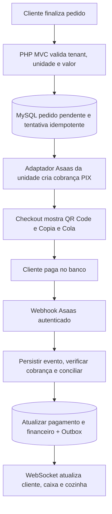
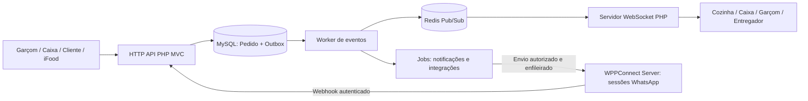
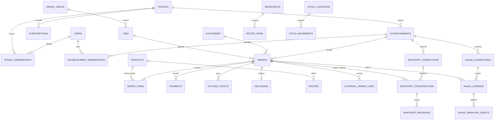

# Cardapim 🍽️

**Cardapim** é uma plataforma SaaS (Software as a Service) de gestão para **restaurantes, bares e lanchonetes**, com assinatura mensal por estabelecimento/empresa, operação multiunidade e atendimento integrado a salão, balcão, retirada e delivery.

> **Status:** projeto em planejamento arquitetural. Este repositório contém inicialmente o escopo técnico e o roteiro de implementação. As funcionalidades descritas abaixo **não estão implementadas** até que sejam entregues em código.
>
> **Infraestrutura informada:** VPS, domínio e SSL já provisionados. A configuração exata, credenciais e serviços devem ser verificados no ambiente antes do deploy.

## Modo caixa

- `/{slug}/caixa` com **menu lateral**: Caixa, Mesas e comandas, Delivery, Entradas e saídas, Fechamentos e Cadastro de mesas.
- **Pedidos de delivery colados no menu**, do mais antigo para o mais novo, com **aviso de pedido novo** (luz laranja piscando em volta da tela, tremida leve e campainha que repete até alguém ver; som liga/desliga no topo), também em todas as telas da gerência. O caixa abre o pedido, aceita, marca pronto e **despacha para o motoqueiro escolhido**; ao entregar, o pagamento entra no caixa.
- **Mesas** (tabela `mesas`): mapa desenhado (mesa com cadeiras) livre/ocupada, todo restaurante começa com 5 mesas e o último quadro "+ Nova mesa" cria a próxima; cadastro (criar uma ou várias, editar, pausar, excluir). A mesa funciona como cliente da **comanda**: lançar itens, cancelar item com motivo, taxa de serviço, desconto, dividir a conta, trocar de mesa, imprimir e receber em uma ou várias formas, com o **troco calculado enquanto digita** e destacado ao fechar a conta. Cancelar a comanda não exige motivo. Venda no balcão usa a mesma comanda.
- **Abrir e fechar caixa** (troco inicial e contagem cega do dinheiro), **entradas e saídas** (reforço, sangria, despesas) e histórico de fechamentos com sobra/falta.
- **Estoque**: item da comanda baixa os insumos na hora; pedido do cardápio baixa quando o cliente pede (o despacho não baixa de novo); cancelar devolve. Conferido nos testes.
- [Arquitetura, regras e tabelas](docs/architecture/caixa.md).

## Painel do garçom

- O garçom entra e já vê as **mesas** (livre/ocupada, total e tempo). Toca na mesa, toca em **Adicionar**, escolhe os produtos com − / + (e observação) e lança tudo de uma vez.
- **Cancelar comanda** (mesa aberta por engano, cliente foi embora): motivo em um toque, confirmação, estoque devolvido. Conta com pagamento só o caixa cancela.
- **Fechar conta**: liga/tira os **10%**, divide por pessoas, escolhe a forma (dinheiro com troco na hora, débito, crédito, Pix) e registra que foi pago.
- Com o **Asaas do restaurante** conectado, aparece **QR Code Pix**: o cliente paga pelo app do banco e a conta fecha sozinha.
- Menu **Cardápio**: busca de produtos com preço e se tem (ou quantos restam).
- Celular primeiro (menu embaixo), tablet e computador. [Detalhes](docs/architecture/garcom.md).

## Avisos do pedido pelo WhatsApp do restaurante

- O cliente recebe mensagens **do WhatsApp conectado pelo gerente** a cada etapa: pedido recebido (com link para acompanhar), em preparo, pronto, **saiu para entrega** (nome do motoqueiro, valor a pagar e link do mapa com a moto), entregue e cancelado (com o motivo).
- O gerente escolhe quais etapas avisar e vê os últimos avisos na tela do WhatsApp. Se o WhatsApp cair, os avisos ficam na fila e saem sozinhos quando reconectar.
- Fila com tabela `pedido_avisos` (outbox, sem repetir aviso). [Detalhes](docs/architecture/avisos-whatsapp.md).
- Menu do gerente: Entregas e Mesas ficam só dentro do **modo caixa**.

## Painel do entregador e rastreio ao vivo

- `/{slug}/entregas` (motoqueiro, no celular): entregas **com você agora** (cliente, endereço, quanto receber e troco, itens, rota no Google Maps ou Waze, ligar, WhatsApp e botão **Entreguei**), **feitas hoje** e resumo de hoje e 7 dias com as taxas.
- **Compartilhar localização** com um toque: o cliente vê o entregador chegando no mapa (OpenStreetMap + Leaflet, sem API paga), com distância e tempo estimado; o caixa também vê no pedido.
- Privacidade: só a última posição é guardada, só o cliente daquele pedido vê, só enquanto está "Saiu para entrega", e a posição é apagada quando para de compartilhar ou termina as entregas.
- O cliente também vê a etapa **Pronto** na linha do tempo do pedido.
- [Arquitetura, regras e rotas](docs/architecture/entregas.md).

## Pedidos, entrega e pagamento

- **Tabelas `pedidos` e `pedido_itens`**: todo pedido tem o restaurante (`id_restaurante`) e de quem e: o cliente (`id_cliente`) e/ou a pessoa da equipe que registrou (`id_user`). Linha do tempo em `pedido_eventos`.
- **Aba "Entrega e pagamento"** do gerente: entrega e/ou retirada, tempo estimado, formas aceitas (Pix pelo app via Asaas do restaurante, Pix na entrega, cartao de debito, cartao de credito e dinheiro) e **areas de entrega por bairro ou por raio em km**, cada uma com taxa e pedido minimo, com "Testar um endereco".
- **Finalizar o pedido** no cardapio: entrega ou retirada, endereco pelo CEP (confere na hora se o restaurante entrega e quanto custa), pagamento (troco, CPF para o Pix) e tela para acompanhar o pedido.
- Geolocalizacao **sem custo**: BrasilAPI/ViaCEP para CEP e Nominatim (OpenStreetMap) para distancia, respeitando a politica de uso (1 consulta/s e cache).
- A equipe recebe, prepara e despacha os pedidos no **modo caixa** (seção acima).
- [Arquitetura, regras e rotas](docs/architecture/pedidos.md).

## App instalável (PWA) da equipe

- A partir do **login** e do **cadastro**, o Cardapim pode ser **instalado no celular** como aplicativo (ícone na tela inicial, tela cheia). No Android/Chrome aparece o botão "Instalar app"; no iPhone, o passo a passo Compartilhar > Adicionar à Tela de Início.
- O app abre no login e leva cada cargo para a sua área (gerência, caixa, entregas, painel). Sem internet, mostra uma tela "Você está sem internet"; páginas e dados nunca ficam guardados no aparelho.
- [Como funciona](docs/architecture/pwa.md).

## Cardapio online do restaurante (cliente final)

- `/{slug-do-restaurante}`: cardapio para o cliente pedir pelo celular, no estilo dos apps de delivery: capa, status aberto/fechado, horarios, busca, abas de categoria que acompanham a rolagem e produtos com botao "+".
- **Sacola**: folha que sobe de baixo com observacao e quantidade; barra fixa "Ver sacola" no celular e painel lateral no computador; guardada no aparelho por 2 dias e **conferida no servidor** (preco e disponibilidade atuais) ao abrir a pagina.
- **Login do cliente sem senha**: so numero do WhatsApp e nome. Codigo de 6 digitos enviado pelo **WhatsApp da plataforma** (`/painel/integracoes/whatsapp` precisa estar conectado), valido por 10 min, com limites de envio e tentativas; aparelho lembrado por 60 dias.
- Tabelas `clientes` (nome, WhatsApp, CPF, endereco completo, ultimo acesso) e `cliente_sessoes`.
- O botao "Continuar" leva para a finalizacao do pedido (secao acima).
- **Seus pedidos**: na conta do cliente (botão com o nome no topo), o histórico de pedidos deste restaurante ou de todos, com status, itens e total; cada pedido abre o acompanhamento. Pedido em andamento aparece em destaque no topo do cardápio com "Acompanhar": basta voltar pelo link do restaurante.
- [Arquitetura, rotas e seguranca](docs/architecture/cardapio-cliente.md).

## Painel da plataforma (administracao)

- `/painel` do adm_master com menu lateral: Dashboard, Restaurantes, Planos, Faturas, Usuarios, Integracoes, Logs de auditoria, Configuracoes, Suporte e Minha conta.
- **Pronta**: Integracoes da plataforma - Asaas para receber as assinaturas dos restaurantes e WhatsApp proprio da plataforma (sessao separada dos restaurantes), base do codigo de verificacao do cliente final.
- **Asaas da plataforma para assinaturas**: chave, avisos (webhook com eventos de assinatura), lista "Pronto para cobrar?" (conta aprovada, chave Pix, avisos ativos) e regras da cobranca recorrente: Pix, Boleto e/ou Cartao, vencimento da 1a cobranca, dias gratis, multa, juros, desconto, dias de atraso para suspender e fatura enviada pelo Asaas. Ciclo mensal, semestral ou anual vem do plano.
- **Planos** (`/painel/planos`): criar, editar, pausar e excluir planos; publicos aparecem no site, privados so com **link de convite**; periodo **vitalicio** e sempre gratis (parceiros). [Detalhes](docs/architecture/assinaturas.md).
- **Restaurantes** (`/painel/restaurantes`): lista com busca e filtros, cadastrar restaurante com gerente e plano (inclusive privado), editar dados e CNPJ, liberar/suspender/desativar com motivo, trocar o plano, ver as contas e excluir quem ainda nao teve movimento. **Usuarios** (`/painel/usuarios`): todas as contas (administradores e equipe dos restaurantes), criar, editar, trocar senha, bloquear, desligar a verificacao em duas etapas e excluir, sem deixar a plataforma sem administrador. [Detalhes](docs/architecture/painel-plataforma.md#restaurantes).
- **Configuracoes** (`/painel/configuracoes`): nome da plataforma, descricao, frase do rodape, logos (SVG/PNG), favicon e icone do app (gera os tamanhos do celular) e **e-mail do sistema** (como envia, sem senha, e botao de e-mail de teste). [Configurar o e-mail](docs/deploy/email.md).
- **Faturas** (`/painel/faturas`): recebido no mes, a receber, vencido e restaurantes em atraso; lista com filtros por situacao, mes e restaurante, link da fatura no Asaas e "Atualizar agora". [Detalhes](docs/architecture/painel-plataforma.md#faturas).
- **Suporte** (`/painel/suporte`): chamados de todos os restaurantes, os que esperam resposta primeiro (selo no menu), responder, resolver e reabrir; aviso por e-mail nos dois sentidos. [Detalhes](docs/architecture/suporte.md).
- **Cadastro e assinatura de verdade**: cadastro cria o restaurante e a assinatura no Asaas da plataforma; o aviso de pagamento libera o cardapio; fatura atrasada alem da tolerancia pausa o acesso (so o gerente entra, para pagar).
- **Cada um no seu lugar**: equipe logada (administrador, gerente, caixa, garcom, motoqueiro) nao volta ao site, catalogo, login, cadastro ou cardapios, sempre cai no proprio painel (gerente ainda abre o proprio cardapio). No cardapio o cliente nao tem caminho para outros restaurantes. [Detalhes](docs/architecture/autenticacao.md).
- Demais secoes mostram "Em construcao" com o que vai ter. [Detalhes](docs/architecture/painel-plataforma.md).

## Tempo real (WebSocket proprio)

- **Servidor WebSocket em PHP** (`bin/tempo-real.php`, systemd), sem dependencias, so em 127.0.0.1 atras do Nginx (`wss://.../ws`).
- **Transactional Outbox**: todo evento e gravado em `outbox_eventos` antes de ser transmitido; o **Redis** so avisa "tem evento novo" (sem Redis, busca a cada 1 s).
- **Seguranca**: ticket assinado de 60 s e uso unico (`GET /api/v1/tempo-real/ticket`), origem conferida, cada restaurante so recebe os proprios eventos e cada cargo so os canais permitidos; conta bloqueada sai em ate 1 minuto.
- **Navegador**: indicador "Ao vivo", reconexao automatica recebendo o que perdeu, aviso "Atualizar agora" quando algo muda em outra tela.
- Ja publica: estoque alterado, aviso do Asaas recebido e WhatsApp conectado/desconectado. Pedidos, cozinha, caixa e chats usam a mesma base quando forem criados.
- [Arquitetura e como publicar eventos](docs/architecture/tempo-real.md) · [Instalacao na VPS](docs/deploy/tempo-real.md).

## Painel do gerente: Visao geral, Estoque, Equipe, Financeiro, Perfil, Assinatura e Minha conta

- **Visao geral**: vendas de hoje comparadas com ontem ate a mesma hora, pedidos em andamento por etapa, mesas ocupadas, caixa, graficos de vendas (7 dias e por hora), mais vendidos, alertas de estoque e de contas e atalhos. Atualiza sozinha quando chega pedido. [Detalhes](docs/architecture/painel-gerente.md#visao-geral).
- **Estoque**: resumo do que acabou, do que esta abaixo do minimo e do que esta fora de venda (com o motivo), valor parado em estoque e reposicao rapida ("chegou mercadoria"); produtos com ficha tecnica dinamica, custo e sobra estimados; insumos com barra de nivel; categorias.
- **Equipe**: contas de caixa, garcom e entregador com senha facil de passar, bloqueio imediato, troca de senha e exclusao (anonimiza quem ja tem historico).
- **Financeiro**: quanto entrou, quanto saiu e o resultado do periodo (hoje, ontem, 7 dias, mes, mes passado ou datas escolhidas), de onde veio e para onde foi o dinheiro, vendas por canal, dia a dia, extrato de entradas e saidas, fechamentos de caixa com sobras e faltas, contas a pagar e a receber (repeticao mensal, "Paguei" em um toque, aviso de vencidas) e planilha para o contador. [Detalhes](docs/architecture/financeiro.md).
- **Perfil**: nome, logo (upload seguro, regravada em WebP), telefone, endereco completo e horario de funcionamento (sempre aberto ou por dia, ate 2 turnos, passando da meia-noite) com selo "Aberto agora".
- **Assinatura**: plano atual, faturas com botao "Pagar agora" (pagina do Asaas: Pix, boleto ou cartao), assinar, trocar, cancelar e desfazer, historico. Cobranca recorrente pelo Asaas da plataforma. [Detalhes](docs/architecture/assinaturas.md).
- **Minha conta**: dados, troca de senha, **verificacao em duas etapas** (Google Authenticator ou codigo por e-mail, com codigos de recuperacao), aparelhos conectados e ultimos acessos.
- Todo cadastro, edicao e exclusao gera log em `log_user` com o que mudou. [Detalhes das abas e rotas](docs/architecture/painel-gerente.md) · [Tabelas novas](docs/database/gerencia-abas.md) · [2FA](docs/architecture/autenticacao.md#verificacao-em-duas-etapas).
- **Integracoes**: Asaas (chave da conta do restaurante, avisos de pagamento por webhook configurados sozinhos), WhatsApp (WPPConnect proprio em Docker, QR Code e mensagem de teste) e iFood (vinculo da loja, pedidos com entregador e codigo de coleta, aceitar/pronto/cancelar indo para o iFood e estoque sincronizado). [Detalhes](docs/architecture/integracoes.md) · [iFood](docs/architecture/ifood.md) · [WPPConnect em Docker](docs/deploy/wppconnect-docker.md).
- **Suporte**: abrir chamado (assunto, sobre o que e, mensagem), conversa com a equipe da plataforma, selo "Resposta nova" no menu, resolver e reabrir respondendo. So o restaurante dono ve o chamado. [Detalhes](docs/architecture/suporte.md).

---

## Endereco dos restaurantes

- `restaurantes` ganhou `cep`, `logradouro`, `numero`, `complemento`, `bairro`, `cidade`, `estado`, `ponto_referencia`, `latitude` e `longitude`, com validacao de CEP (8 digitos), UF e coordenadas no banco.
- O Restaurante Modelo foi completado com dados de demonstracao; o e-mail e o do gerente vinculado. [Detalhes](docs/database/restaurantes-endereco.md).

---

## Cardapio, insumos e ficha tecnica (base do painel do gerente)

- Tabelas `categorias`, `insumos`, `produtos` e `produto_insumos` (ficha tecnica), todas com `id_restaurante` e FKs compostas que impedem misturar dados entre restaurantes no proprio banco.
- Insumos em `un`, `kg` ou `l` com 3 casas decimais numa unica coluna (`0.080` kg = 80 g). Estoque **nunca negativo**: faltou insumo, o produto fica indisponivel e a venda e recusada.
- `app/Modules/Inventory`: disponibilidade (com quantas unidades ainda podem ser vendidas) e baixa atomica pela ficha tecnica, pronta para o modulo de pedidos.
- [Detalhes das tabelas e regras](docs/database/cardapio-estoque.md).

---

## Login e areas por cargo

- **`/login` funcionando**: entra com e-mail ou nome de usuario e leva cada cargo para sua area: `adm_master` -> `/painel`, `gerente` -> `/{slug}/gerencia`, `caixa` -> `/{slug}/caixa`, `motoqueiro` -> `/{slug}/entregas`, `garcom` e `cliente` -> `/minha-conta`.
- **Bloqueio por cargo e por restaurante** validado no servidor: sem login vai para `/login`; sem permissao recebe 403. O gerente tambem acessa caixa e entregas do proprio restaurante; o `adm_master` acessa tudo.
- Sessao segura, CSRF, limite de tentativas que falham, auditoria em `log_user` (login, login automatico, recusa, alerta e logout, com navegador) e `ultimo_acesso`.
- **Esqueci minha senha** (`/recuperar-senha`): link no e-mail da conta, assinado, valido por 1 hora e de uso unico; a resposta nunca revela se a conta existe; a senha nova desconecta os aparelhos lembrados e a verificacao em duas etapas continua valendo. Equipe sem e-mail pede a senha nova ao gerente. [Detalhes](docs/architecture/autenticacao.md#esqueci-minha-senha).
- **Manter conectado por 30 dias** (opcional no login), com token trocado a cada uso e encerramento automatico se o cookie for copiado. Tabela `user_sessoes_lembradas`. Detalhes: [autenticacao e acesso por cargo](docs/architecture/autenticacao.md).
- As telas de cada area sao introdutorias nesta etapa; as ferramentas de cada cargo serao construidas nas proximas entregas.
- Contas de teste em producao: senhas no arquivo privado `shared/backups/acessos-cardapim-testes.txt` da VPS. O `adm_master` de teste continua **desativado** por seguranca.

---

## Catalogo de restaurantes, CNPJ obrigatorio e verificacao ao digitar

- **Menu Restaurantes** (landing, cabecalho das paginas internas e rodape) leva a **`/catalogo`**: lista os restaurantes **ativos** com rolagem infinita (12 por vez), busca por nome sem recarregar a pagina e link "Ver mais" quando o JavaScript nao estiver disponivel. `/restaurantes` redireciona para `/catalogo`.
- Clicar em um restaurante abre **`/{slug}`** (ex.: `/restaurante-modelo-cardapim`): pagina provisoria "Cardapio digital em preparacao". Slugs inexistentes, inativos ou reservados retornam 404. A rota `/{slug}` e a ultima registrada; novas rotas fixas devem entrar antes dela e em `Cardapim\Shared\Slug::RESERVADOS`.
- **CNPJ obrigatorio no cadastro**: a coluna `restaurantes.cnpj` ja existia (`CHAR(14)`, unica). Agora o formulario exige CNPJ valido e o banco recebeu `CHECK` de 14 digitos (migration `20261110030000_check_cnpj_restaurantes.php`, com indice do catalogo). `NULL` continua aceito no banco para o Restaurante Modelo e dados de demonstracao.
- **Usuario, e-mail e CNPJ unicos com aviso enquanto digita**: o formulario consulta `GET /api/v1/cadastro/disponibilidade` (450 ms apos parar de digitar), mostra "Verificando...", "disponivel" ou "ja cadastrado". Limite de 60 consultas por IP a cada 5 minutos. Os indices `UNIQUE` do banco continuam sendo a garantia final.
- [Documentacao da API v1](docs/api/v1.md).

---

## Interface publica lapidada (icones, mascaras e animacoes)

- **Icones Lucide** (licenca ISC) servidos por sprite local `public/assets/icons/lucide.svg`, sem CDN. Uso no PHP: `Cardapim\Core\Icon::svg('chef-hat')`. Para adicionar icones: incluir o nome em `dev/icons/icons.txt` e rodar `php dev/icons/build-sprite.php <lucide/icons>`. Emojis foram removidos das telas e o CI bloqueia emojis e estilos inline em `app/Views`.
- **CSS organizado**: `core.css` (tokens da paleta, botoes, cabecalho, rodape, animacoes e `prefers-reduced-motion`), `site.css` (landing) e `pages.css` (acesso, erros e documentos legais).
- **JS externo com `defer`**: `core.js` (cabecalho ao rolar, menu movel, link ativo, revelar ao rolar, voltar ao topo), `site.js` (painel 3D que acompanha o cursor, contadores, pedidos ao vivo ilustrativos, palavra rotativa, progresso das etapas) e `forms.js` (mascaras e validacao).
- **Mascaras e validacao no navegador**: CPF, CNPJ, telefone/WhatsApp, CEP e nome de usuario, com mensagens claras, mostrar/ocultar senha e medidor de forca. O backend deve revalidar com `Cardapim\Shared\Validation\Documento` (CPF, CNPJ e telefone) quando o cadastro for ativado.
- **Rodape** compartilhado (`app/Views/partials/footer.php`) em colunas: Produto, Acesso e Legal, com icones, CNPJ e botao voltar ao topo.
- **Robustez**: a landing nao cai mais se o MySQL estiver indisponivel (logos oficiais locais como reserva e aviso na secao de planos); uma conexao PDO por requisicao; pagina 500 propria.
- **Cadastro real** (`POST /cadastro`): cria restaurante, gerente, mesas e assinatura; plano gratis/convite entra direto, plano pago gera a fatura no Asaas. [Detalhes](docs/architecture/assinaturas.md).

---

## Contas de teste dos seis cargos

- Seeder privado `php8.4 database/seed-test-users.php --apply` cria somente contas de demonstracao dos cargos cliente, gerente, motoqueiro, garcom, caixa e adm_master; as cinco contas comuns sao do Restaurante Modelo Cardapim.
- O `adm_master` de teste e global e **desativado**, para nao deixar uma conta superadministradora de demonstracao operacional na producao.
- As senhas sao geradas com `random_bytes()`, armazenadas no MySQL via `password_hash()` e entregues exclusivamente em arquivo privado `shared/backups/acessos-cardapim-testes.txt` (permissao 600). Nunca imprimir em logs ou versionar no Git.
- O WhatsApp dos testes e definido por `CARDAPIM_TEST_WHATSAPP` no `shared/.env` privado ou como variavel temporaria no terminal autorizado, nunca no Git. O arquivo de exemplo contem a chave vazia.
- **A rota /login ainda e uma pagina de preparacao:** as contas existem no banco, mas nao podem autenticar ate a implementacao de login.
- [Comandos e controles de seguranca](docs/database/initial-schema.md).

---

## Telas públicas e documentos legais

- `/login`: tela simples, centralizada e responsiva, com formulário visual **desativado** até implementarmos autenticação segura.
- `/cadastro?plano_id=<id>` (plano publico) e `/cadastro?convite=<codigo>` (plano privado do link de convite).
- Rotas legais: `/privacidade`, `/termos-de-uso`, `/cookies`, `/exclusao-de-dados` e `/tratamento-de-dados`. A landing possui links para todas no rodapé.
- Rotas não encontradas retornam HTTP **404** com view própria, responsiva e sem CSS inline.
- CSS exclusivo destas páginas em `public/assets/css/pages.css`; branding utiliza os arquivos oficiais e caminhos de logo salvos em `configuracoes` (com fallback textual em erros).
- Os textos legais são **versões iniciais em revisão** baseadas no guia interno de segurança/LGPD: faltam confirmação de dados institucionais, endereço e canal de privacidade; não devem ser apresentados como homologação jurídica final.
- [Pendências de revisão jurídica e operacional](docs/legal/revisao.md).

---

## Usuarios e vinculo com auditoria

- Tabela `user` com cargos `cliente`, `gerente`, `motoqueiro`, `garcom`, `caixa` e `adm_master`.
- Coluna `cpf CHAR(11) NULL` (somente digitos, unica, com `CHECK`), adicionada pela migration `20261110020000_add_cpf_user.php`. Exibir sempre mascarado (`Documento::mascararCpf`).
- `adm_master` e global, sem vinculo a restaurante; os demais cargos exigem `id_restaurante` valido. Indices facilitam consultas isoladas por restaurante e cargo.
- Campos de identificacao, contatos, senha em hash, ultimo acesso, codigo temporario em hash e validade do codigo. Sem credenciais em texto puro.
- `log_user.id_user` passa a ser uma FK para `user.id`; para nao perder historico, contas com logs precisam ser desativadas (`ativo=0`), nao apagadas.
- A estrutura de usuarios **nao inclui autenticacao, painel ou criacao automatica de uma conta master**. Os perfis e permissoes deverao ser validados no backend quando essas funcionalidades forem desenvolvidas.
- Detalhes: [schema versionado](docs/database/initial-schema.md).

---

## Planos na landing page

A pagina inicial possui a secao `/#planos` e o link **Planos** na navegacao. Os cards sao gerados a partir da tabela `planos` via `PlanoRepository::listarPublicos()`, com filtro **`ativo = 1 AND visibilidade = 1`** e ordenacao mensal, semestral e anual. Cada card apresenta nome, descricao, valor total por periodo e botao **Assinar**, que leva a `/cadastro?plano_id=<id>`. O `id` corresponde diretamente a chave primaria do banco, sem valores fixos no frontend.

Os links levam ao cadastro com o plano ja marcado. Caso nao haja planos elegiveis, a secao mostra uma mensagem orientativa em vez de cards vazios. Esta entrega nao altera tabelas nem inclui CSS/JavaScript inline.

---

## Configuracoes globais e restaurante modelo

- `configuracoes` centraliza os caminhos das logos oficiais, o favicon e textos publicos padrao; as paginas consultam as URLs das logos diretamente do MySQL.
- O dominio base (`APP_URL`) continua no arquivo privado `.env`. CSS, JS e outras imagens internas usam `AssetUrl::asset(...)`, evitando repeticao de URLs e consultas desnecessarias.
- Um `Restaurante Modelo Cardapim` foi cadastrado em produção no plano **Demonstração Mensal**, com campos de contato e pagamento vazios; os cadastros iniciais sao idempotentes.
- [Schema e comandos do banco](docs/database/initial-schema.md).

---

## Primeiras tabelas e monitoramento de saúde

- **/status**: página de status de PHP 8.4 e da conexão MySQL (HTTP 200 quando conectado; 503 quando indisponível). Resposta JSON com cabeçalho `Accept: application/json`.
- **planos**: nome, descrição, valor `DECIMAL(10,2)`, período mensal/semestral/anual, ativo, visibilidade (`1` por padrão) e timestamps.
- **restaurantes**: nome, telefone, e-mail, CNPJ, slug, logo, status, último pagamento, timestamps e chave estrangeira `plano_id` para planos.
- **log_user**: tabela de auditoria (`id`, `titulo`, `descricao`, `id_user`, `data_hora`, `ip`), com FK para `user.id`.
- Duas migrations MySQL versionadas e testes de integração em CI. O deploy do código é automático quando habilitado; a criação efetiva das tabelas em produção depende de aplicar as migrations com backup.
- [Esquema e comandos para a VPS](docs/database/initial-schema.md).

---

## 🚀 Primeira entrega de código — landing page e roteamento

A estrutura inicial em **PHP 8.4 MVC, pastas, URLs amigáveis, `.htaccess` Apache, configuração Nginx e landing page responsiva** foi adicionada ao repositório. As rotas `/`, `/login` e `/cadastro` estão preparadas. O hero possui animações CSS e há um botão **Entrar** no canto superior direito.

**Importante:** as páginas de login e cadastro são temporárias, ainda sem autenticação. Integrações e operação dos restaurantes seguem como módulos planejados.

Para executar localmente: `php -S localhost:8000 -t public dev/router.php`. Na VPS com Nginx/CloudPanel, o DocumentRoot deve ser a pasta `/public` e o vhost precisa da regra `try_files`. Detalhes no [guia da fase 0A](docs/implementation/phase-0.md).

---
## Identidade visual oficial

A identidade visual oficial foi fornecida nos arquivos SVG e substitui os elementos gráficos provisórios da landing page:

| Cor | Hexadecimal | Uso sugerido |
| --- | --- | --- |
| **Vinho** | `#651424` | Fundo principal, detalhes de marca e títulos |
| **Branco** | `#FFFFFF` | Texto em fundo escuro, áreas claras e respiro |
| **Laranja** | `#FF5825` | Botões, chamadas de atenção e destaques |

**Logos originais:** [`logo-branca.svg`](public/assets/img/logo-branca.svg), [`logo-colorida.svg`](public/assets/img/logo-colorida.svg) e [`logo-preta.svg`](public/assets/img/logo-preta.svg). **Ícone oficial:** [`icone.svg`](public/assets/img/icone.svg), também usado como favicon. A landing usa a logo colorida no cabeçalho e a branca no rodapé. Todas as versões estão preservadas sem alterações de formas.

Os SVGs de origem incluem variações mínimas de canal de cor (`#651423` e `#FE5826`), mas **o CSS segue exatamente a paleta oficial informada: `#651424`, `#FFFFFF` e `#FF5825`**.

---
## Deploy automatizado via GitHub

A estrutura para CI/CD está em [`.github/workflows/ci-deploy.yml`](.github/workflows/ci-deploy.yml). Cada atualização na `main` executa verificação de PHP 8.4, Composer, JavaScript e rotas da landing page. **O deploy só acontece se `CARDAPIM_DEPLOY_ENABLED=true` estiver configurado no GitHub**, com os secrets SSH, diretório e URL do CloudPanel validados.

O deploy será realizado por usuário não-root, com releases versionadas, armazenamento e `.env` fora do código, symlink `current`, healthcheck HTTP e rollback de arquivos por symlink quando necessário. **Migrations MySQL só serão executadas se `CARDAPIM_RUN_MIGRATIONS=true`, com backup prévio e credenciais privadas.** Isso não substitui a análise dos riscos de migrations DDL.

Informações de infraestrutura fornecidas: domínio `deliveryzim.com.br` (desde 11/11/2026; o site no CloudPanel continua com o nome antigo `cardapim.escotilhaprodutora.com`, que redireciona), banco `cardapim`, usuário MySQL `cardapim-user`, host MySQL `127.0.0.1`, porta `3306`, usuário do site `escotilhaprodutora-cardapim`. **Nenhuma senha deve ser colocada no Git ou compartilhada no chat.**

Leia o [guia completo de deploy no CloudPanel](docs/deploy/cloudpanel.md). Troca de domínio (deliveryzim.com.br): [passo a passo](docs/deploy/troca-de-dominio.md).

**Nome da marca configurável:** todo texto que mostra o nome da plataforma (telas, títulos, WhatsApp, e-mails, app instalável, autenticador) usa `configuracoes.nome_sistema` (hoje "Deliveryzim") por `marca()` (texto) e `marca_html()` (HTML); no JavaScript, `<meta name="application-name">`. Logos vêm de `logo_colorida`, `logo_branca`, `logo_preta` e `icone`. Código interno (namespace `Cardapim\`, logs `[Cardapim]`, nomes de cookies e sessões) continua igual. O fluxo SSH e publicação da landing page foi validado na VPS em 09/11/2026; migrations automáticas permanecem desativadas até a configuração de backup.

---
## 1. Visão do produto

A proposta é centralizar a operação diária de cada negócio em uma experiência simples, rápida, responsiva e automatizada:

- **Pedidos multicanal:** mesas, balcão/PDV, cardápio digital, retirada, delivery próprio e iFood.
- **Catálogo e estoque:** produtos, variações, adicionais, fichas técnicas, insumos, compras, baixas e alertas.
- **Caixa e financeiro:** abertura/fechamento, entradas/saídas, pagamentos, contas a pagar/receber, taxas, conciliação e relatórios.
- **Cozinha (KDS):** fila em tempo real para TV/tablet, prioridades, setores de produção e conclusão por item/pedido.
- **Garçom e mesas:** lançamento de comandas, adicionais, transferência, divisão de conta e solicitação de fechamento.
- **Delivery:** despacho, atribuição de entregadores, acompanhamento de status e rastreamento consentido durante entregas próprias.
- **Gestão empresarial:** painéis de vendas, margem, desempenho, ticket médio, produtos mais vendidos e auditoria.
- **SaaS multi-restaurante:** cadastro de empresas, unidades, usuários, permissões, planos, assinaturas e limites de uso.
- **WhatsApp por restaurante (WPPConnect):** cada unidade conecta seu número por QR Code, atende conversas em uma caixa de entrada própria, recebe solicitações, acompanha pedidos e configura mensagens/fluxos automáticos com supervisão humana.
- **Pix Asaas por restaurante:** cada unidade conecta sua conta Asaas própria para receber os pedidos online, com QR dinâmico, confirmação, conciliação e financeiro isolado.

### Princípios

1. **Multi-tenant desde o primeiro commit:** nenhuma empresa deve acessar dados de outra.
2. **Monólito modular em PHP MVC:** módulos internos bem separados, sem criar microsserviços prematuramente.
3. **Dados financeiros confiáveis:** pedido, pagamento, saldo em caixa, recebível e receita são conceitos distintos.
4. **Automação tolerante a falhas:** ações importantes são persistidas antes de eventos em tempo real.
5. **Interfaces por função:** cada colaborador vê apenas o que precisa para trabalhar.
6. **Segurança e rastreabilidade:** permissões, logs, consentimento de localização, backup e observabilidade.
7. **Mobile-first/PWA:** garçom, cliente e entregador precisam funcionar bem no celular.
8. **Comunicações isoladas:** nenhuma sessão, mensagem, token ou automação do WhatsApp de uma loja pode alcançar outra sem autorização explícita.

---

## 2. Modelo de negócio e isolamento de empresas

Hierarquia sugerida:

```text
Cardapim (plataforma)
├── Administração global / SaaS
│   ├── Planos e assinaturas
│   ├── Empresas e unidades
│   ├── Faturamento da plataforma
│   └── Suporte, auditoria e monitoramento
├── Empresa A (tenant)
│   ├── Unidade A1 (establishment)
│   └── Unidade A2 (establishment)
└── Empresa B (tenant)
    └── Unidade B1 (establishment)
```

- **Tenant:** empresa contratante, com assinatura, configurações e limites.
- **Establishment:** restaurante/loja/unidade operacional, com mesas, estoque, caixa, pedidos, integração e equipe.
- **User:** identidade de acesso; usuários internos recebem vínculos com tenant/unidade e papéis.
- **Customer:** cliente final que compra pelo cardápio, com histórico e dados delimitados por empresa.
- **Platform admin:** administrador da Cardapim, separado do administrador de cada tenant.

**Estratégia inicial:** um banco MySQL compartilhado, com `tenant_id` em toda entidade pertencente a uma empresa e `establishment_id` nas entidades operacionais por unidade. A autorização deve resolver o tenant/unidade no servidor e validar o vínculo do usuário; **nunca confiar em um `tenant_id` enviado pelo navegador**.

O sistema deve ter testes de isolamento entre tenants e preferencialmente chaves/índices compostos que impeçam associações acidentais entre empresas. Tabelas estritamente globais (por exemplo, `plans`) não precisam de `tenant_id`.

### Assinaturas

- Planos mensais com limites configuráveis (unidades, usuários, pedidos/recursos, armazenamento e integrações), incluindo **quantidade de conexões WhatsApp/sessões ativas**.
- Período de teste opcional, cobrança recorrente, vencimento, renovação, inadimplência e cancelamento.
- Bloqueio/grace period com regras claras, preservação de dados e acesso administrativo quando aplicável.
- Gateway de **mensalidades da plataforma** desacoplado por interface (Asaas possível), independente das contas Asaas que os restaurantes vinculam para receber seus pedidos.
- Webhooks de cobrança verificados, idempotentes e auditáveis; sem assumir pagamento por uma simples notificação não validada.

---

## 3. Perfis e permissões

As permissões são **RBAC por tenant/unidade**, com possibilidade de criar funções personalizadas no futuro. Um mesmo usuário pode ter diferentes funções em unidades distintas.

| Perfil | Escopo | Atribuições principais |
| --- | --- | --- |
| **Superadmin Cardapim** | Plataforma | Gerenciar tenants, planos, assinaturas, suporte e segurança global |
| **Administrador / proprietário** | Empresa/unidade | Configurações, catálogo, colaboradores, estoque, relatórios e financeiro |
| **Gerente** *(sugerido)* | Unidade | Supervisionar pedidos, equipe, estoque e operações autorizadas |
| **Atendente WhatsApp** *(permissão atribuível)* | Unidade | Responder conversas autorizadas, criar rascunhos de pedidos, transferir atendimento e consultar status sem acesso ao financeiro completo |
| **Caixa** | Unidade | PDV, abertura/fechamento de turno, pagamentos, sangria, suprimento, troco, estornos autorizados |
| **Garçom** | Unidade | Abrir comandas, lançar pedidos/adicionais, gerir mesas e solicitar fechamento |
| **Cozinha** | Unidade/setor | Visualizar fila, iniciar preparo, marcar itens/pratos prontos e sinalizar indisponibilidade |
| **Entregador / motoboy** | Unidade/entregas atribuídas | Aceitar/acompanhar entregas, abrir rotas, atualizar status e compartilhar localização consentida |
| **Cliente** | Cardápio público / própria conta | Consultar cardápio, pedir delivery/retirada, acompanhar pedido e histórico próprio |

O perfil **ADM do restaurante não equivale ao superadmin da plataforma**. A autorização ocorre em **toda requisição HTTP e assinatura de canal WebSocket**, não apenas escondendo botões na interface.

Permissões granulares previstas: `orders.create`, `orders.cancel`, `orders.discount`, `cash.open`, `cash.close`, `cash.refund`, `inventory.adjust`, `finance.read`, `finance.manage`, `users.manage`, `settings.manage`, `integrations.manage`, `whatsapp.connect`, `whatsapp.inbox.read`, `whatsapp.messages.send`, `whatsapp.automations.manage`, entre outras.

---

## 4. Módulos funcionais

### 4.1 Plataforma SaaS
- Landing page, cadastro, onboarding e ativação do estabelecimento.
- Planos, assinatura mensal, histórico de cobranças e controle de elegibilidade.
- Painel global de empresas, status, suporte e métricas da plataforma.
- Parametrização por tenant e flags de recursos por plano.
- Gestão de limites de sessões WhatsApp por plano; provisionamento/desativação auditável quando o estabelecimento muda de plano.

### 4.2 Produtos, cardápio e preços
- Categorias, produtos, imagens, descrição, disponibilidade, SKU e código interno.
- Tamanhos/variações, grupos de adicionais, combos, observações e preços por canal/unidade.
- Cardápio digital com URL pública por estabelecimento (ex.: `/loja/{slug}`), QR Code e opção de personalização.
- Promoções, cupons e horário de venda; impostos e configurações fiscais como módulo próprio a definir.
- Pausa de produtos esgotados, com atualização de catálogo externo apenas quando suportada pela integração.

### 4.3 Estoque, insumos e compras
- Cadastro de insumos, unidades de medida, conversão de unidades e fichas técnicas (receitas).
- Estoque por unidade/local, entradas, perdas, ajustes, transferências e inventários.
- Compras, fornecedores, custo médio/custo definido e alerta de estoque mínimo.
- **Regra a especificar por operação:** reservar insumos na confirmação do pedido e consumi-los no início da produção ou outro marco configurado; cancelamentos e estornos precisam de lançamentos de reversão para evitar baixa em duplicidade.
- Controle de concorrência em estoque e trilha de movimentações; nunca ajustar saldo sem registrar movimento.

### 4.4 Mesas, comandas e garçom
- Mapa de mesas com status: livre, ocupada, aguardando pedido/fechamento e limpeza (configurável).
- Comanda individual ou por mesa; identificação de clientes opcionais.
- Pedidos incrementais enviados à cozinha sem reimprimir itens antigos.
- Transferência de mesa, divisão de conta, taxa de serviço configurável e fechamento.

### 4.5 PDV e caixa
- Vendas rápidas no balcão, consumo local e retirada.
- Sessões de caixa por operador/terminal: abertura, fundo de troco, sangria, suprimento, conferência e fechamento.
- Múltiplos meios de pagamento, pagamentos parciais, troco, descontos e estornos com permissão.
- Diferença entre valor esperado e contado, justificativa e histórico de alterações.
- Impressão de comandas e comprovantes como integração opcional; documento fiscal exige análise específica de requisitos legais e fiscais.

### 4.6 Cozinha (KDS)
- Painel em tempo real para TV/tablet, organizado por chegada, prioridade e estação (cozinha, bar etc.).
- Estados de preparo por item e por pedido; temporizador e sinalização visual de atrasos.
- Novo pedido gera ticket; alterações/cancelamentos são mostrados claramente.
- Interface de alto contraste, fullscreen e opção de alerta sonoro configurável.

### 4.7 Delivery, retirada e entregador
- Área de entrega, taxa/frete, disponibilidade por bairro/CEP/região e pedido mínimo.
- Checkout do cliente com endereço validado, observações, método de pagamento e previsão **estimada**.
- Despacho de entregas próprias, atribuição de motoboy, aceite, coleta, rota e comprovante de entrega.
- Acompanhamento público do pedido via token seguro e expirável.
- **Localização:** solicitar consentimento explícito ao entregador; enviar coordenadas somente durante entrega ativa, restringir a clientes autorizados e interromper a coleta ao concluir/cancelar. Definir retenção mínima e política LGPD.
- Rotas/ETA dependem de provedor de mapas/roteamento a contratar ou implementar; não presumir que o WebSocket calcula rotas.
- Diferenciar **entrega própria** de **entrega gerenciada pelo iFood**; não presumir acesso à geolocalização do entregador do iFood.

### 4.8 Financeiro e relatórios
- Vendas brutas/líquidas, descontos, cancelamentos, taxas, custo de produto (CMV estimado), margem e ticket médio.
- Contas a pagar/receber, despesas, categorias e centros de custo.
- Movimentos de caixa físico versus pagamentos digitais e recebíveis de marketplaces.
- Conciliação de repasses e taxas do iFood/gateways **quando houver dados disponíveis**.
- Relatórios por empresa, unidade, caixa, canal, produto, período e colaborador; exportação CSV/PDF.
- Histórico contábil **append-only** para movimentos relevantes; corrigir com lançamentos de reversão, não apagando o passado.

### 4.9 Integração com iFood

**Implementado** ([detalhes](docs/architecture/ifood.md)): pedidos do iFood entram sozinhos no Delivery do caixa (polling a cada 30 s pela rotina `bin/ifood.php`, avisos guardados antes da confirmação de leitura, sem duplicar), entregador do iFood com etapa e código de coleta, aceitar/pronto/despachar/cancelar enviados ao iFood, concluído e cancelado vindos do iFood, venda no iFood baixando o estoque e disponibilidade dos itens enviada ao iFood pelo estoque (tela "Cardápio do iFood" para ligar itens a produtos). Para ligar em produção: app distribuído homologado, `IFOOD_CLIENT_ID/SECRET` no `shared/.env` e o cron da rotina.

Planejamento original:
- Conexão e autorização por estabelecimento (`merchantId` ↔ `establishment_id`).
- Recebimento de pedidos/eventos na **Merchant API oficial** via Webhook e/ou Polling.
- Validação de autenticidade, persistência de payload original, deduplicação por ID do evento e processamento assíncrono.
- Consulta de detalhes e sincronização de status: aceitação/confirmação, preparo, pronto, despacho, cancelamento e conclusão **conforme capacidades da API e da modalidade de entrega**.
- Reconciliação periódica e reprocessamento seguro de falhas.
- Pedido iFood entra na mesma fila operacional/financeira, identificado pelo canal `ifood`, sem ser contabilizado como dinheiro recebido no caixa quando o pagamento/repasses forem externos.
- Catálogo, disponibilidade, taxas e financeiro do marketplace são integrações separadas, adicionadas apenas depois de validar módulos e permissões disponíveis.

**Dependência externa:** cadastro no Portal do Desenvolvedor do iFood, ambiente de testes, credenciais, requisitos empresariais e homologação para produção. Não considerar a integração ativa até a autorização ser concluída.

Documentação oficial:
- [Portal iFood Developer](https://developer.ifood.com.br/pt-BR)
- [Guia de integração de pedidos (Food)](https://developer.ifood.com.br/en-US/docs/food/guides/modules/order/workflow)
- [Webhooks, entrega e resiliência](https://developer.ifood.com.br/en-US/docs/food/guides/modules/events/webhook-overview)
- [Eventos de pedidos](https://developer.ifood.com.br/en-US/docs/food/guides/modules/order/events)

> Para integrações com múltiplas lojas, o webhook de autenticação centralizada é indicado pela documentação oficial. Webhooks podem chegar **duplicados e fora de ordem**: o código deve ser idempotente. O webhook não substitui um mecanismo de reconciliação.

### 4.10 Pix online — conta Asaas de cada restaurante (planejado)

**Modelo:** cada restaurante/unidade cadastra e utiliza a sua própria conta Asaas, com recebimento Pix direto nessa conta, sem passar pelo saldo da Cardapim. A conta que cobra as **mensalidades da plataforma SaaS** é separada das contas de recebimento dos restaurantes. O escopo inicial é **Pix por QR Code dinâmico** para pedidos do cardápio online, retirada e delivery próprio; outros meios, split e subcontas ficam para futura avaliação.

#### Funcionalidades para o estabelecimento

- Painel **Configurações → Integrações → Asaas**: conectar, verificar e desconectar a chave API da conta própria; escolher Sandbox ou Produção, visualizar apenas status, conta vinculada (quando disponível) e data da última validação. Somente ADM ou perfil autorizado pode gerenciar a conexão.
- **Uma conta ativa por unidade** como regra inicial: cada loja pode ter credenciais distintas. O backend resolve a conta pelo `tenant_id` e `establishment_id` autenticados; não aceitar identificador de loja ou conta enviado pelo checkout como autoridade.
- O cliente fecha o pedido online, escolhe Pix e recebe **QR Code e Pix Copia e Cola** com valor calculado no servidor. A interface apresenta status do pagamento, sem exigir atualização manual.
- Pedido recém-criado fica em `pending_payment`, sem contabilizar recebimento. Confirmação por **webhook Asaas autenticado**, validada por conexão, cobrança, pedido e valor. Pagamento recebido atualiza pedido, caixa digital/financeiro e cozinha conforme a política de produção da loja.
- Vendas, taxas, valores líquidos, estornos, reconciliações e pagamentos atrasados aparecem no financeiro daquela unidade. Não misturar o Pix recebido na conta Asaas com dinheiro físico em caixa.
- Se a integração cair, não marcar nenhum pedido como pago por suposição; manter pendente e reconciliar por worker. Uma loja com credencial inválida não afeta os pagamentos de outra.

#### Fluxo principal



#### Integração e regras de segurança

1. **API oficial:** chave da conta Asaas no header `access_token`, utilizada **somente pelo backend PHP**. Separar endpoints e credenciais de Sandbox e Produção. Criar cobrança com `billingType: PIX` em `POST /v3/payments` (ou modalidade `POST /v3/lean/payments` homologada) e buscar QR Code em `GET /v3/payments/{id}/pixQrCode`: `encodedImage`, `payload`, `expirationDate`. Recomenda-se chave Pix já cadastrada na conta. Validar validade real do QR Code; o timeout de um checkout não significa expiração do Pix.
2. **Segredos:** chave API criptografada em repouso, suporte a rotação/revogação e permissões `asaas.manage`, `payments.read`, `payments.refund`. Nunca enviar chave ao frontend, armazená-la em logs, commitar ou reutilizar chave global da Cardapim.
3. **Webhook por conexão:** endpoint `POST /webhooks/asaas/{connectionKey}` com chave pública opaca; token próprio por conexão configurado na conta Asaas, validado no header `asaas-access-token`. Comparação segura e conferência de `account.id`, `payment.id`, `externalReference`, valor e escopo do pedido quando disponíveis. Não aceitar callback apenas porque conhece o identificador na URL.
4. **Idempotência:** gravar evento por `UNIQUE(connection_id, external_event_id)` antes de retornar **HTTP 200**; processar fora da requisição. Retries/duplicidades ou eventos fora de ordem não criam segunda cobrança, segundo pagamento, segunda baixa de estoque nem duplicam financeiro. Guardar a intenção e conciliar falhas de tempo limite antes de criar outra cobrança.
5. **Estados reais:** a emissão do QR Code **não é pagamento**. O Asaas envia `PAYMENT_CREATED`, `PAYMENT_RECEIVED`, e pode enviar eventos de vencimento, estorno e outros. `PAYMENT_RECEIVED` indica valor disponível; `PAYMENT_CONFIRMED` é um evento distinto, sem equivalência automática a saldo disponível. Não retroceder pagamento já recebido para pendente; registrar reversões separadamente.
6. **Pedidos cancelados e pagamento tardio:** cancelar o pedido é diferente de cancelar/estornar cobrança Asaas. Se um Pix chegar após timeout ou cancelamento, criar alerta e tratar reembolso/regularização com auditoria. QR Code dinâmico está vinculado à cobrança e não deve ser reutilizado para vários pedidos.
7. **Privacidade:** dados do pagador, CPF/CNPJ e identificadores externos somente quando necessários, com acesso por unidade, retenção LGPD e logs sem segredos/dados sensíveis. Checkout público consulta apenas seu pedido por autorização/token seguro.
8. **Mensalidades separadas:** webhook de planos SaaS continua em `/webhooks/billing/{provider}`; webhook de pagamentos de pedidos usa `/webhooks/asaas/{connectionKey}`. Não confundir nenhuma cobrança de assinatura com receitas do restaurante.

#### Estrutura de pastas prevista

```text
app/Modules/Payments/               # orquestração, tentativa e estado de pagamento
app/Modules/Integrations/Asaas/     # cliente REST, conectores por loja e webhooks
config/payments.php                  # ambientes, limites, timeouts (sem segredos de lojas)
workers/payment_reconcile.php       # recuperação de webhooks e conciliação
```

#### Tabelas MySQL previstas

| Tabela | Principais colunas/finalidade |
| --- | --- |
| `asaas_connections` | `id`, `tenant_id`, `establishment_id`, `environment`, `provider_account_id`, `api_key_encrypted` (ou secret ref), `webhook_secret_ref`, `public_connection_key`, `status`, `last_validated_at` |
| `asaas_customers` | `id`, `tenant_id`, `establishment_id`, `connection_id`, `customer_id`, `asaas_customer_id`; o cliente externo pertence àquela conta |
| `asaas_charges` | `id`, `tenant_id`, `establishment_id`, `connection_id`, `order_id`, `asaas_payment_id`, `external_reference`, `gross_amount DECIMAL(14,2)`, `fee_amount`, `net_amount`, `status`, `due_date`, `paid_at` |
| `asaas_webhook_events` | `id`, `tenant_id`, `establishment_id`, `connection_id`, `external_event_id`, `event_type`, `payload_json`, `status`, `processed_at` |
| `asaas_refunds` | `id`, `tenant_id`, `establishment_id`, `charge_id`, `external_refund_id`, `amount`, `status`, `requested_by`, `created_at` |
| `asaas_reconciliation_runs` | `id`, `tenant_id`, `establishment_id`, `connection_id`, `started_at`, `finished_at`, `status`, `result_json` |

**Índices:** `UNIQUE(public_connection_key)` para conexão; `UNIQUE(connection_id, asaas_payment_id)` quando ID externo existir; `UNIQUE(connection_id, external_event_id)` para webhooks, além dos índices por `tenant_id`, `establishment_id`, `order_id` e datas. Validar vínculos com FKs compostas e manter snapshot financeiro imutável com estornos/reversões.

#### API planejada

```http
GET    /api/v1/establishments/{id}/integrations/asaas
POST   /api/v1/establishments/{id}/integrations/asaas/connect
POST   /api/v1/establishments/{id}/integrations/asaas/rotate-key
DELETE /api/v1/establishments/{id}/integrations/asaas
POST   /api/v1/establishments/{id}/orders/{orderId}/pix
GET    /api/v1/establishments/{id}/orders/{orderId}/pix
GET    /api/v1/establishments/{id}/payments/asaas
POST   /webhooks/asaas/{connectionKey}
```

**Fontes oficiais:** [Visão geral](https://docs.asaas.com/docs/visao-geral) · [Autenticação](https://docs.asaas.com/docs/autentica%C3%A7%C3%A3o-1) · [Cobrança Pix dinâmica](https://docs.asaas.com/docs/cobrancas-via-pix) · [Eventos de cobrança](https://docs.asaas.com/docs/webhook-para-cobrancas) · [Receber webhook](https://docs.asaas.com/docs/receba-eventos-do-asaas-no-seu-endpoint-de-webhook) · [Idempotência](https://docs.asaas.com/docs/como-implementar-idempotencia-em-webhooks).

> **Implementação pendente:** homologar a API no Sandbox com duas contas/unidades e validar condições comerciais, credenciais de terceiros, retorno de webhooks, pagamento tardio, duplicação e estornos antes da produção.

---
### 4.11 WhatsApp por restaurante — WPPConnect Server (módulo planejado)

**Objetivo:** permitir que **cada estabelecimento conecte e utilize seu próprio WhatsApp** dentro do Cardapim para atendimento, solicitações de pedidos, confirmações e acompanhamento, sem acessar a sessão de outra empresa. Prever inicialmente **1 sessão por unidade**, com expansão para mais números por plano/necessidade.

#### Funcionalidades e experiência

1. **Conectar número:** administrador/gerente autorizado abre `Configurações → Integrações → WhatsApp`, solicita conexão, visualiza o **QR Code de pareamento** e acompanha estados `disconnected`, `pairing`, `connected`, `reconnecting`, `error`. Pode reconectar e desconectar; número e status ficam visíveis apenas a quem tem acesso à unidade.
2. **Central de atendimento (inbox):** conversas, mensagens recebidas/enviadas, nome e telefone do contato, não lidas, responsável, tags, notas internas, busca, filtros e atribuição para atendentes, com atualização em tempo real.
3. **Atendimento comercial:** compartilhar link do cardápio digital, receber perguntas, anexos e solicitações de clientes; cadastrar/vincular cliente e **transformar conversa em rascunho de pedido** para revisão de itens, endereço, entrega, preços e confirmação explícita antes de criar pedido operacional. Mensagem de texto livre **não deve automaticamente gerar cobrança ou baixa de estoque**.
4. **Mensagens transacionais:** confirmação de pedido, alteração de status, retirada pronta, saiu para entrega e conclusão; respeitar preferências do cliente, viabilidade técnica e regras aplicáveis de envio.
5. **Automação configurável por loja:** saudação, horário de funcionamento, menu de opções, respostas frequentes, aviso de indisponibilidade, consulta de status, transferência para humano e disparos por eventos de pedido. Fila de envio, tentativas limitadas, prevenção de loops, pausa manual e agendamento em horário adequado.
6. **Operação assistida:** funcionário assume conversa a qualquer momento, suspende automação para aquele contato, registra responsável e histórico de interações. Uma falha no WhatsApp não pode impedir o PDV, a cozinha nem pedidos de outros canais.
7. **Relatórios:** volume de mensagens, tempo de primeira resposta, conversas atendidas, pedidos originados do WhatsApp e falhas de envio por loja, sem confundir mensagens com vendas.
8. **Mídia e segurança:** mídia suportada pelo WPPConnect pode ser exibida após validação de tamanho/tipo, acesso autenticado e armazenamento privado com retenção configurada. Nunca expor link interno do servidor WPPConnect ao cliente final.

#### Arquitetura e isolamento

- **WPPConnect Server** é um serviço **Node.js separado**, hospedado na VPS ou em instância dedicada, acessado **somente pelo backend PHP** via API REST autenticada. O frontend nunca recebe a chave mestra nem tokens de sessão do WPPConnect.
- **PHP MVC continua sendo o cérebro do negócio:** controla tenant/unidade, RBAC, regras comerciais, inbox, automações, pedidos e banco MySQL. O WPPConnect cuida das **sessões WhatsApp e transporte de mensagens**, não decide valores, pagamentos ou autorização.
- **Mapeamento obrigatório:** cada sessão WPPConnect recebe identificador interno opaco e vínculo persistente com `tenant_id` + `establishment_id`; IDs de sessão, callbacks e eventos recebidos são resolvidos **no servidor**. Não confiar em tenant, unidade ou sessão informados em payload externo.
- **Fluxo inbound:** evento do WPPConnect → endpoint interno `/webhooks/wppconnect` autenticado/protegido → resolução da sessão → registro de evento bruto/deduplicação → job → contato, conversa e mensagem → WebSocket autorizado da inbox → opcional automação ou rascunho de pedido.
- **Fluxo outbound:** usuário autorizado ou evento de pedido → comando PHP validado → mensagem persistida como `queued` → fila/worker com rate limit e idempotência → chamada à API do WPPConnect → atualização de status e recibos quando disponíveis. Não prometer entrega apenas pelo aceite HTTP.
- **Conexão e QR:** o PHP obtém o QR Code/estado do serviço de sessão e o expõe somente em endpoint protegido da unidade; dados de pareamento têm vida curta e não entram em logs. Estados de conexão são refletidos na UI pelo WebSocket PHP.
- **Escalabilidade:** múltiplas sessões consomem processos/Chromium, CPU e memória; adotar limites por plano e por nó, monitorar recursos e reiniciar sessões com supervisão. Para múltiplos nós, usar atribuição persistida de sessão a uma instância e roteamento correto; não presumir que sessões possam ser movidas sem restaurar estado.
- **Resiliência:** eventos recebidos podem ser duplicados, atrasar ou chegar fora de ordem. Deduplicar por sessão + tipo + ID externo da mensagem/evento, registrar falhas, aplicar retry/backoff, dead-letter e reconciliação possível. As filas MySQL/Outbox e Redis são separadas da lógica de sessão.
- **Privacidade e conformidade:** coletar apenas dados necessários, restringir acesso por tenant, controlar consentimento/preferência para campanhas e mensagens não transacionais, permitir retenção/exclusão adequada e aplicar LGPD. Respeitar regras da plataforma e limites de envio; **sem disparos em massa não solicitados**.
- **Risco de integração:** WPPConnect é projeto independente, **não é a API oficial WhatsApp Business da Meta**; sessões podem desconectar, requerer novo QR Code ou sofrer limitações/bloqueios conforme o serviço e termos aplicáveis. Prever adaptador de provedor para eventual migração à API oficial, sem reescrever pedidos e inbox.
- **Webhook:** proteger por rede privada/reverse proxy, credencial de serviço ou outro mecanismo de autenticação implementado e verificar origem do evento. **Não presumir assinatura criptográfica nativa** se não estiver comprovada na versão instalada.

#### Dependências e documentação

- [WPPConnect Server — repositório oficial](https://github.com/wppconnect-team/wppconnect-server)
- [WPPConnect Server — documentação](https://wppconnect.io/pt-BR/docs/projects/wppserver/introduction/)
- [WPPConnect Server — referência de API](https://wppconnect.io/swagger/wppconnect-server/)

A integração está **planejada e não implementada**. Antes do desenvolvimento validar a versão escolhida, endpoints, licenças, persistência de sessões, política de backup, capacidade de hardware, regras de uso e requisitos de autenticação/webhook.

---

## 5. Arquitetura técnica proposta

| Camada | Tecnologia/abordagem |
| --- | --- |
| Backend | **PHP 8.4**, orientação a objetos, MVC, Composer e autoload PSR-4 |
| Banco | **MySQL 8.x** com InnoDB, transações, FKs, migrations e índices compostos |
| Frontend | HTML/Twig + JavaScript modular (Fetch), Tailwind CSS; componentes reativos onde necessário |
| Infra | **Nginx + PHP-FPM** na VPS; somente `/public` exposto na web |
| Realtime | **Servidor WebSocket próprio, hospedado na VPS**, processo PHP independente do PHP-FPM (ex.: Workerman) |
| Eventos/jobs | **Redis** para pub/sub, cache, filas e controle de presença; worker PHP supervisionado |
| Persistência de eventos | **Transactional Outbox** em MySQL, com retry e idempotência |
| API | REST JSON versionada em `/api/v1`, com sessão/token conforme o consumidor |
| WhatsApp | **WPPConnect Server em Node.js**, processo separado, com múltiplas sessões e webhooks; adaptador REST no PHP MVC |
| Pix online | **Asaas API por estabelecimento**, com chave própria protegida, QR Code, webhook autenticado e conciliação |
| Integrações | Adaptadores HTTP/Webhook separados (iFood, WPPConnect, cobrança e mapas) |
| Aplicação móvel | Web responsivo e PWA, com restrições de navegador respeitadas |
| Operação | systemd/Supervisor, cron/worker, logs estruturados, métricas, backup e deploy via GitHub Actions (planejado) |

### Fluxo de pedidos em tempo real



**Regra fundamental:** o comando de negócio entra por HTTP/API, passa por autorização e transação e é gravado no MySQL. O WebSocket **transmite eventos confirmados**; não é fonte de verdade e não executa baixas financeiras/estoque sem passar pela camada de negócio.

### Canais WebSocket (exemplos)

```text
tenant.{tenantId}.establishment.{establishmentId}.orders
tenant.{tenantId}.establishment.{establishmentId}.kitchen
tenant.{tenantId}.establishment.{establishmentId}.tables
tenant.{tenantId}.establishment.{establishmentId}.cash
delivery.{deliveryId}.tracking
tenant.{tenantId}.establishment.{establishmentId}.whatsapp.inbox
tenant.{tenantId}.establishment.{establishmentId}.whatsapp.connection
```

Os nomes acima são exemplos internos: a assinatura exige **ticket de curta duração**, autenticação, autorização por tenant/unidade e escopo específico. O servidor valida `Origin`, limite de conexões e mensagens; não aceita IDs arbitrários do cliente como prova de permissão.

Eventos típicos: `order.created`, `order.updated`, `order.cancelled`, `kitchen.ticket.created`, `kitchen.item.ready`, `table.updated`, `cash.session.closed`, `delivery.assigned`,  `delivery.location.updated`, `whatsapp.session.updated`, `whatsapp.message.received`, `whatsapp.message.status.updated`. Todo evento deve trazer `event_id`, `tenant_id`, `establishment_id`, versão/ordem lógica quando cabível e `occurred_at`.

**Disponibilidade:** implementar reconexão com backoff, heartbeat e reidratação do estado via API. Redis Pub/Sub sozinho não garante entrega; a Outbox persiste a intenção e permite retentativas.

---

## 6. Estrutura de pastas sugerida

```text
cardapim/
├── app/
│   ├── Core/
│   │   ├── Application.php
│   │   ├── Router.php
│   │   ├── Controller.php
│   │   ├── Database.php
│   │   ├── Request.php
│   │   ├── Response.php
│   │   ├── Middleware/
│   │   ├── Auth/
│   │   ├── Tenancy/
│   │   ├── Events/
│   │   └── Exceptions/
│   ├── Modules/
│   │   ├── Platform/          # tenants, planos, assinatura, superadmin
│   │   ├── Identity/          # usuários, autenticação, RBAC
│   │   ├── Establishments/    # unidades e configurações
│   │   ├── Catalog/           # produtos, preços, adicionais, combos
│   │   ├── Inventory/         # insumos, receitas, movimentações
│   │   ├── Orders/            # pedidos, itens, status, origem
│   │   ├── Tables/            # mesas e comandas
│   │   ├── POS/               # caixa, sessões e pagamentos locais
│   │   ├── Kitchen/           # tickets e filas KDS
│   │   ├── Delivery/          # entregadores, despachos e tracking
│   │   ├── Customers/         # clientes e endereços
│   │   ├── Finance/           # lançamentos, despesas, recebíveis
│   │   ├── Payments/          # pagamentos Pix e estado de cobranças
│   │   ├── Reports/           # consultas e exportações
│   │   ├── WhatsApp/          # inbox, contatos, atendentes, mensagens, automações
│   │   ├── Integrations/
│   │   │   ├── IFood/
│   │   │   ├── WPPConnect/     # adaptador REST, sessões e normalização de webhooks
│   │   │   ├── Asaas/          # Pix API, conta por loja, eventos
│   │   │   ├── Billing/
│   │   │   └── Maps/
│   │   └── Notifications/
│   ├── Shared/
│   │   ├── DTO/
│   │   ├── Contracts/
│   │   ├── Support/
│   │   └── Validation/
│   └── Views/
│       ├── layouts/
│       ├── platform/
│       ├── admin/
│       ├── pos/
│       ├── waiter/
│       ├── kitchen/
│       ├── inbox/             # atendimento WhatsApp por estabelecimento
│       ├── courier/
│       └── storefront/
├── bootstrap/
│   └── app.php
├── config/
│   ├── app.php
│   ├── database.php
│   ├── permissions.php
│   ├── realtime.php
│   ├── whatsapp.php
│   ├── payments.php
│   └── services.php
├── database/
│   ├── migrations/
│   ├── seeders/
│   └── factories/
├── public/
│   ├── index.php
│   ├── assets/
│   └── manifest.webmanifest
├── resources/
│   ├── css/
│   ├── js/
│   ├── images/
│   └── lang/
├── routes/
│   ├── web.php
│   ├── api.php
│   └── webhooks.php
├── realtime/
│   ├── server.php          # processo WebSocket PHP (não HTTP-FPM)
│   ├── Auth/
│   ├── Channels/
│   └── Handlers/
├── workers/
│   ├── outbox.php
│   ├── queue.php
│   ├── whatsapp_dispatch.php # fila de envio e automações, sem bloquear HTTP
│   ├── payment_reconcile.php # reconciliação assíncrona Asaas
│   └── reconciler.php
├── storage/
│   ├── logs/
│   ├── cache/
│   ├── uploads/
│   └── exports/
├── tests/
│   ├── Unit/
│   ├── Integration/
│   ├── Feature/
│   └── Tenancy/
├── deploy/
│   ├── nginx/
│   ├── systemd/
│   └── scripts/
├── docs/
│   ├── architecture/
│   ├── api/
│   ├── database/
│   ├── integrations/
│   └── decisions/
├── .env.example
├── .gitignore
├── composer.json
├── package.json
└── README.md
```

Cada módulo em `app/Modules/Nome/` pode conter `Controllers/`, `Models/`, `Services/`, `Repositories/`, `Policies/`, `DTO/` e `Events/` conforme a necessidade. Não criar camadas vazias apenas por convenção. O core lida com infraestrutura transversal, **não com regras específicas de pedidos ou estoque**.

Arquivos sensíveis (`.env`, tokens, uploads privados e backups) ficam fora do repositório e, idealmente, fora do diretório público. Não versionar credenciais.

---

## 7. Banco de dados — desenho inicial

**SGBD:** MySQL/InnoDB. Convenções: `id BIGINT UNSIGNED` como chave interna; FKs explícitas; timestamps UTC (`created_at`, `updated_at` e, quando aplicável, `deleted_at`); dinheiro em `DECIMAL(14,2)` (nunca `FLOAT`); valores transacionais imutáveis/snapshots para preservar o histórico. IDs externos em `VARCHAR`, conforme cada provedor.

### 7.1 Tabelas agrupadas por domínio

| Domínio | Tabelas principais | Finalidade |
| --- | --- | --- |
| Plataforma | `tenants`, `establishments`, `plans`, `plan_features`, `subscriptions`, `subscription_invoices`, `billing_webhook_events` | Contratantes, unidades e mensalidades |
| Acesso | `users`, `tenant_memberships`, `establishment_memberships`, `roles`, `permissions`, `role_permissions`, `sessions`, `audit_logs` | Identidade, papéis, autorização e auditoria |
| Cardápio | `categories`, `products`, `product_variants`, `modifier_groups`, `modifiers`, `product_modifier_groups`, `product_prices`, `combos` | Itens, complementos e preço por canal |
| Estoque | `ingredients`, `stock_locations`, `stock_balances`, `stock_movements`, `recipes`, `recipe_items`, `stock_reservations`, `suppliers`, `purchase_orders`, `purchase_order_items`, `stock_counts` | Insumos e rastreabilidade de saldo |
| Atendimento | `dining_tables`, `tabs`, `tab_customers`, `orders`, `order_items`, `order_item_modifiers`, `order_status_history`, `order_discounts`, `order_adjustments` | Mesas, comandas, pedidos e itens |
| Cozinha | `kitchen_stations`, `kitchen_tickets`, `kitchen_ticket_items` | Fluxo de produção e telas KDS |
| Caixa | `cash_registers`, `cash_sessions`, `cash_movements`, `payment_methods`, `payments`, `payment_refunds` | Operação de PDV, caixa e recebimentos |
| Delivery | `delivery_zones`, `delivery_drivers`, `deliveries`, `delivery_assignments`, `delivery_status_history`, `delivery_location_consents` | Logística de entrega própria |
| Clientes | `customers`, `customer_addresses`, `customer_tenant_links` | Compradores, dados de entrega e vínculo à empresa |
| Financeiro | `financial_categories`, `financial_accounts`, `financial_entries`, `accounts_payable`, `accounts_receivable`, `settlements`, `reconciliations` | Fluxo financeiro, obrigações e repasses |
| Integrações | `integration_connections`, `external_order_links`, `integration_events`, `integration_sync_logs` | Conexões, IDs externos e eventos |
| WhatsApp | `whatsapp_connections`, `whatsapp_contacts`, `whatsapp_conversations`, `whatsapp_messages`, `whatsapp_message_events`, `whatsapp_assignments`, `whatsapp_automation_flows`, `whatsapp_automation_runs`, `whatsapp_opt_ins` | Sessões por unidade, contatos e inbox, envio, eventos, atendimentos, automações e preferências |
| Pix Asaas por loja | `asaas_connections`, `asaas_customers`, `asaas_charges`, `asaas_webhook_events`, `asaas_refunds`, `asaas_reconciliation_runs` | Contas independentes por unidade, cobranças Pix, confirmação, estornos e conciliação |
| Infra/eventos | `event_outbox`, `job_attempts`, `idempotency_keys`, `notification_logs` | Entrega confiável, retry e deduplicação |

> Esta é uma **proposta de modelagem**, não um schema já migrado. As tabelas serão criadas por migrations versionadas e revisadas por fluxo, com restrições de tenant e índices planejados.

### 7.2 Relacionamentos fundamentais



### 7.3 Campos críticos (primeira migração de negócio)

| Tabela | Campos de atenção |
| --- | --- |
| `tenants` | `id`, `name`, `slug`, `status`, `timezone`, `created_at` |
| `establishments` | `id`, `tenant_id`, `name`, `slug`, `document`, `address_json`, `is_active` |
| `users` | `id`, `name`, `email`, `password_hash`, `status`, `last_login_at` |
| `tenant_memberships` | `tenant_id`, `user_id`, `role_id`, `status` |
| `establishment_memberships` | `tenant_id`, `establishment_id`, `user_id`, `role_id`, `status` |
| `products` | `id`, `tenant_id`, `name`, `sku`, `active`, `created_at` |
| `product_prices` | `id`, `tenant_id`, `establishment_id`, `product_id`, `channel`, `amount` |
| `orders` | `id`, `tenant_id`, `establishment_id`, `customer_id`, `tab_id`, `channel`, `type`, `status`, `payment_status`, `subtotal`, `discount_total`, `delivery_fee`, `total`, `currency`, `placed_at` |
| `order_items` | `id`, `tenant_id`, `order_id`, `product_id`, `product_name_snapshot`, `quantity`, `unit_price`, `total`, `notes` |
| `payments` | `id`, `tenant_id`, `establishment_id`, `order_id`, `cash_session_id`, `method_id`, `amount`, `status`, `provider`, `external_reference`, `paid_at` |
| `cash_sessions` | `id`, `tenant_id`, `establishment_id`, `cash_register_id`, `opened_by`, `opened_at`, `closed_at`, `opening_amount`, `expected_amount`, `counted_amount`, `status` |
| `stock_movements` | `id`, `tenant_id`, `establishment_id`, `stock_location_id`, `ingredient_id`, `quantity_delta`, `unit_cost`, `reason`, `reference_type`, `reference_id`, `created_at` |
| `deliveries` | `id`, `tenant_id`, `establishment_id`, `order_id`, `driver_id`, `status`, `assigned_at`, `picked_up_at`, `completed_at`, `tracking_token_hash` |
| `integration_events` | `id`, `tenant_id`, `integration_connection_id`, `provider`, `external_event_id`, `event_type`, `payload_json`, `status`, `processed_at` |
| `whatsapp_connections` | `id`, `tenant_id`, `establishment_id`, `provider`, `session_key`, `server_node`, `phone_e164`, `status`, `token_secret_ref`, `connected_at`, `disconnected_at` |
| `whatsapp_contacts` | `id`, `tenant_id`, `establishment_id`, `external_contact_id`, `phone_e164`, `display_name`, `customer_id`, `created_at` |
| `whatsapp_conversations` | `id`, `tenant_id`, `establishment_id`, `connection_id`, `contact_id`, `order_id` (opcional), `assigned_user_id`, `status`, `automation_paused`, `last_message_at` |
| `whatsapp_messages` | `id`, `tenant_id`, `establishment_id`, `conversation_id`, `external_message_id`, `direction`, `message_type`, `body`, `delivery_status`, `sent_at`, `received_at` |
| `whatsapp_message_events` | `id`, `tenant_id`, `connection_id`, `event_type`, `external_event_key`, `payload_json`, `processed_at`, `status` |
| `whatsapp_automation_flows` | `id`, `tenant_id`, `establishment_id`, `name`, `trigger`, `configuration_json`, `is_active`, `version` |
| `event_outbox` | `id`, `tenant_id`, `aggregate_type`, `aggregate_id`, `event_type`, `payload_json`, `status`, `attempts`, `available_at`, `published_at` |

**Índices/constraints prioritários:**

- Unicidade de `tenants.slug`, `establishments(tenant_id, slug)` e vínculo de usuários por escopo.
- Índices `orders(tenant_id, establishment_id, placed_at)`, `orders(tenant_id, establishment_id, status, placed_at)` e `payments(tenant_id, paid_at)`.
- Unicidade de eventos externos **dentro do escopo do provedor/conexão**, por exemplo `UNIQUE(integration_connection_id, external_event_id)`.
- `whatsapp_connections`: `UNIQUE(provider, server_node, session_key)`; todas as consultas por `(tenant_id, establishment_id)`; impedir vínculo de sessão entre tenants. Limite de conexões ativas por unidade/plano validado transacionalmente.
- `whatsapp_messages`: `UNIQUE(conversation_id, external_message_id)` quando o ID externo existir; `whatsapp_message_events`: chave idempotente composta por conexão, tipo e identificador externo. Índices de inbox por `(tenant_id, establishment_id, last_message_at)`.
- Identificadores de contato devem preservar o ID real do provedor (incluindo variantes como LID) e não depender somente de número de telefone; normalização e vinculação de contatos precisam ser explícitas.
- Chave externa composta com `tenant_id` quando necessário para impedir vínculos de linhas entre tenants.
- `stock_balances` único por `(tenant_id, establishment_id, stock_location_id, ingredient_id)`; concorrência com transação e lock.
- `event_outbox(status, available_at)` para workers e `idempotency_keys(scope, key)` com expiração.
- Soft delete apenas onde fizer sentido: pedidos, movimentos financeiros e auditoria não devem desaparecer por exclusão lógica sem regra de retenção.

### 7.4 Regras de consistência

1. Criar pedido, itens, snapshots de preço, reservas e evento Outbox na **mesma transação** quando pertinente.
2. Repetir webhooks ou retries não pode gerar pedidos, pagamentos nem movimentações duplicadas.
3. Cancelamentos/estornos geram eventos e lançamentos reversos; não sobrescrever históricos.
4. Pedido recebido **não equivale** a pagamento liquidado; um pedido iFood pago na plataforma gera recebível/repasse, não entrada imediata de dinheiro no caixa.
5. Toda atualização de pedido usa máquina de estados e log de transições; mudanças inválidas são recusadas.
6. Mudança de preço/nome no catálogo não altera o comprovante de uma venda já realizada.
7. Mensagem WhatsApp não é pedido nem pagamento: só criar pedido após validação e confirmação pelo fluxo de Orders; novos pedidos usam a mesma transação/Outbox dos demais canais.
8. Retry de envio ou webhook WhatsApp não duplica mensagem de saída, contato, conversa nem pedido. Segredos de sessões nunca são salvos em campos de texto comuns ou retornados ao frontend.

---

## 8. Ciclo de vida de pedidos

Origens: `pos`, `waiter`, `storefront`, `ifood`, `whatsapp`, com tipo `dine_in`, `pickup` ou `delivery`. O sistema deve manter **origem, tipo, status operacional e status financeiro separados**.

```text
Novo / aguardando confirmação
          |
      Confirmado
          |
     Em preparo
          |
         Pronto
       /      \
Servido/       Saiu para entrega
Retirado              |
       \           Entregue
        \           /
          Concluído

Cancelado: transição autorizada a partir de estados permitidos;
           exige justificativa e compensações de estoque/financeiro.
```

**Pagamento Pix online tem status próprio** (`pending_payment`, `paid`, `refunded`, `failed`, conforme mapeamento de eventos), independente do status de produção do pedido. Não liberar pagamento com base na simples emissão de QR Code.

Estados sugeridos: `pending`, `confirmed`, `preparing`, `ready`, `served`, `out_for_delivery`, `delivered`, `picked_up`, `completed`, `cancelled`. Os estados disponíveis dependem do tipo de pedido e do provedor; integração externa mantém mapeamento de status próprio.

**KDS:** um pedido pode criar tickets para diferentes estações. O status do pedido é derivado/controlado a partir das tarefas de preparo e da expedição; cada item mantém sua própria etapa.

---

## 9. API e rotas (proposta inicial)

```http
POST   /api/v1/auth/login
GET    /api/v1/me
GET    /api/v1/establishments/{id}/dashboard
GET    /api/v1/establishments/{id}/products
POST   /api/v1/establishments/{id}/orders
GET    /api/v1/establishments/{id}/orders
PATCH  /api/v1/establishments/{id}/orders/{orderId}/status
GET    /api/v1/establishments/{id}/tables
POST   /api/v1/establishments/{id}/tabs
POST   /api/v1/establishments/{id}/cash-sessions
POST   /api/v1/establishments/{id}/cash-sessions/{id}/close
GET    /api/v1/establishments/{id}/kitchen/tickets
GET    /api/v1/establishments/{id}/stock
POST   /api/v1/establishments/{id}/stock/movements
GET    /api/v1/establishments/{id}/finance/summary
GET    /api/v1/establishments/{id}/deliveries
PATCH  /api/v1/establishments/{id}/deliveries/{id}/status
POST   /api/v1/realtime/ticket
GET    /api/v1/establishments/{id}/whatsapp/connection
POST   /api/v1/establishments/{id}/whatsapp/connect
POST   /api/v1/establishments/{id}/whatsapp/disconnect
GET    /api/v1/establishments/{id}/whatsapp/conversations
GET    /api/v1/establishments/{id}/whatsapp/conversations/{conversationId}/messages
POST   /api/v1/establishments/{id}/whatsapp/conversations/{conversationId}/messages
PATCH  /api/v1/establishments/{id}/whatsapp/conversations/{conversationId}/assignment
GET    /api/v1/establishments/{id}/whatsapp/automations
POST   /api/v1/establishments/{id}/whatsapp/automations
POST   /webhooks/asaas/{connectionKey}
POST   /webhooks/wppconnect
POST   /webhooks/ifood
POST   /webhooks/billing/{provider}
GET    /loja/{slug}
POST   /loja/{slug}/pedidos
GET    /acompanhar/{token}
```

Rotas ilustrativas, sujeitas a desenho de autorização, rate limit, paginação, validação e contrato OpenAPI. Endpoints públicos devem proteger contra abuso, tentativas de enumeração, fraude e exposição de dados pessoais.

---

## 10. Segurança, LGPD e operação

- Hash de senhas com Argon2id, proteção CSRF para sessão, cookies `Secure`/`HttpOnly`/`SameSite` e HTTPS obrigatório.
- RBAC no backend, separação por tenant/unidade, MFA para perfis críticos quando implementado e auditoria de ações sensíveis.
- `prepared statements`/PDO, validação server-side, escape de templates, Content Security Policy e proteção de upload.
- Segredos fora do Git; criptografia de tokens de integrações em repouso; rotação de credenciais.
- Webhook com autenticação/assinatura conforme provedor, replay protection e deduplicação persistente. Para WPPConnect, definir autenticação no reverse proxy/serviço quando a versão não fornecer assinatura nativa.
- Sessões WPPConnect, chaves mestras, tokens e perfis de navegador criptografados/protegidos em disco; serviço WPPConnect sem acesso público administrativo, com allowlist de webhook e segregação de permissões.
- Tratar conversas como dados pessoais: políticas de retenção, acesso por perfil, anonimização/exclusão legalmente cabível e opt-in de comunicações promocionais. Evitar exibir mensagens privadas em auditoria/telemetria.
- Backup automatizado do MySQL e uploads privados, retenção, restauração testada e alarmes para filas paradas.
- Logs estruturados por `request_id`, `tenant_id` e `establishment_id`, **sem gravar tokens, dados completos de cartão ou localização desnecessária**.
- LGPD: base legal/consentimento conforme finalidade, transparência, exclusão/anônimização quando cabível e retenção limitada.
- Localização ao vivo com acesso limitado a entrega ativa, token expirá​vel, periodicidade moderada e interrupção quando finalizada.
- Aplicar políticas de reembolso/chargeback e restrições de acesso em caso de inadimplência sem excluir dados automaticamente.
- Cobrança, informações fiscais, emissão de NFC-e e requisitos locais devem ser validados antes de anunciar funcionalidades fiscais.

---

## 11. Fluxo de deploy previsto

```text
GitHub main
   ↓ CI: testes, análise estática, build de assets
Release / deploy controlado na VPS
   ↓ composer install --no-dev + migrations revisadas
Nginx → public/index.php → PHP-FPM
   ├── MySQL
   ├── Redis
   ├── Worker Outbox / Jobs (systemd)
   ├── WebSocket PHP (systemd + proxy Nginx em WSS)
   └── WPPConnect Server Node.js (container/processo isolado + volumes persistentes)
         └── webhook privado → PHP /webhooks/wppconnect
```

- Publicar **somente** `public/` no webroot.
- Processos de worker e websocket independentes do pool PHP-FPM, com restart automático.
- `wss://<dominio-configurado>/realtime` via Nginx com upgrade e TLS; o domínio exato deve ser confirmado.
- Healthchecks para HTTP, DB, Redis, workers, WebSocket e WPPConnect; deploy com rollback e backup antes de migrations destrutivas.
- Isolar a API/Manager do WPPConnect por firewall/rede interna, com credenciais próprias, volumes de sessão persistentes e backups protegidos; verificar CPU/RAM, dependências do Chromium e limites de sessões simultâneas.
- Ambientes `local`, `staging` e `production`, cada qual com segredos próprios.
- Não executar automaticamente migrations destrutivas em produção.

### Variáveis de ambiente previstas

```dotenv
APP_ENV=local
APP_URL=http://localhost
APP_KEY=            # opcional: base64 de 32 bytes; sem ele, storage/keys/app.key e criado sozinho
MAIL_DRIVER=smtp    # smtp (recomendado, mailcow), mail (mail() do servidor) ou log (CI/desenvolvimento)
MAIL_FROM=          # remetente, ex.: no-reply@deliveryzim.com.br (docs/deploy/email.md)
MAIL_HOST=          # servidor SMTP (ex.: mailcow da VPS)
MAIL_PORT=587
MAIL_ENCRYPTION=tls # tls (STARTTLS na 587), ssl (465) ou none
MAIL_USERNAME=
MAIL_PASSWORD=      # so no shared/.env da VPS
WPPCONNECT_BASE_URL=http://127.0.0.1:21467   # WPPConnect proprio (docs/deploy/wppconnect-docker.md)
WPPCONNECT_SECRET_KEY=
DB_HOST=127.0.0.1
DB_PORT=3306
DB_DATABASE=cardapim
DB_USERNAME=cardapim
DB_PASSWORD=
REDIS_HOST=127.0.0.1
REDIS_PORT=6381     # Redis do Cardapim (vazio = tempo real sem Redis)
REDIS_PASSWORD=
WS_ATIVO=1          # liga o tempo real nas telas (docs/deploy/tempo-real.md)
WS_PORTA=8091       # servidor WebSocket local (bin/tempo-real.php)
WS_URL=             # opcional; padrao wss://{APP_URL}/ws
IFOOD_CLIENT_ID=
IFOOD_CLIENT_SECRET=
WPPCONNECT_BASE_URL=http://127.0.0.1:21465
WPPCONNECT_SECRET_KEY=
WPPCONNECT_WEBHOOK_SHARED_SECRET=
WPPCONNECT_WEBHOOK_ALLOWED_URL=
WHATSAPP_CONNECTIONS_LIMIT_DEFAULT=1
ASAAS_SANDBOX_BASE_URL=https://api-sandbox.asaas.com/v3
ASAAS_PRODUCTION_BASE_URL=https://api.asaas.com/v3
# API key de cada restaurante inserida e protegida no painel, não no .env global.
BILLING_PROVIDER=
BILLING_WEBHOOK_SECRET=
```

Valores acima são **exemplos de nomes**, não credenciais válidas. O `.env.example` será criado ao iniciar a implementação.

---

## 12. Roadmap de execução

| Fase | Entregáveis | Critério de aceite |
| --- | --- | --- |
| **0 — Fundação** | Bootstrap PHP MVC, Router, Composer, Twig, MySQL migrations, ambiente, CI, autenticação, tenants e RBAC | Dois tenants isolados por testes; deploy HTTP funcional |
| **1 — Operação básica (MVP)** | Unidades, catálogo, mesas/comandas, pedidos, caixa/PDV, pagamentos e KDS | Pedido do garçom aparece na cozinha e no caixa, com fechamento auditável |
| **2 — Realtime robusto** | WebSocket PHP próprio, Redis, Outbox, workers, reconnect e canais autorizados | Eventos sem perda silenciosa, sem vazamento entre restaurantes |
| **3 — Estoque + financeiro** | Insumos, fichas técnicas, reservas/baixas, compras, relatórios, despesas e recebíveis | Venda e cancelamento geram lançamentos corretos e reversíveis |
| **4 — Cardápio online + delivery** | QR Code, checkout público, retirada, áreas/taxas, despacho, entregador e rastreamento consentido | Cliente acompanha pedido; entregador vê apenas as suas entregas |
| **5 — SaaS comercial** | Onboarding, planos, assinatura, cobrança, inadimplência, painel plataforma e limites | Tenant é criado, assina e acessa somente recursos do plano |
| **6 — WhatsApp/WPPConnect** | Conexão por QR Code por estabelecimento, sessão e webhook, inbox com RBAC, fila de envio, automações supervisionadas e métricas | Duas lojas conectam números diferentes; mensagens e sessões não vazam entre tenants; pedido via chat exige confirmação |
| **7 — Pix Asaas por unidade** | Conexão de conta própria, QR dinâmico, checkout, webhook seguro, financeiro e reconciliação | Duas lojas usam contas distintas; confirmação não duplica financeiro ou pagamento; Pix tardio tratado | 
| **8 — iFood** | Cadastro developer, OAuth/conexões, webhook/polling, status, retries, homologação e conciliação | Pedido iFood entra uma vez, percorre fluxo correto e mantém rastreabilidade |
| **9 — Expansão** | Fiscal, impressão, BI avançado, promoções, fidelidade, integrações e múltiplas unidades avançadas | Recursos validados com usuários reais |

**MVP inicial recomendado:** concluir primeiro o ciclo **cadastro → produto → mesa/PDV → pedido → cozinha → pagamento → fechamento**; depois acrescentar estoque profundo, delivery, comercialização SaaS e integração oficial iFood sem reescrever o núcleo. A ordem pode mudar por necessidade de mercado, mas o isolamento multi-tenant, as regras financeiras e o modelo de eventos devem nascer na fase 0.

### Critérios de qualidade por entrega

- Testes unitários para domínio, integração para banco/filas e testes de isolamento tenant.
- Permissões verificadas no backend por função e estabelecimento.
- Transações e idempotência cobertas por testes de repetição/concorrência.
- Documentação atualizada da API, migrations reversíveis quando possível e changelog.
- Logs e tratamento de erros que permitam diagnosticar pedidos travados, divergências de caixa, falhas iFood e desconexões/eventos duplicados do WhatsApp.
- Teste ponta a ponta de 2 tenants/3 unidades: conexão de WhatsApp, QR Code, inbox, RBAC, autoatendimento pausado e mensagens idempotentes em reconexão.

---

## 13. Decisões e pendências arquiteturais

- [x] Nome do produto: **Cardapim**.
- [x] Modelo de negócio: SaaS por assinatura mensal.
- [x] Backend: PHP MVC; hospedagem em VPS com domínio/SSL provisionados.
- [x] Realtime: WebSocket **próprio no servidor**, sem depender de serviço SaaS de push.
- [x] Multi-restaurante e múltiplas funções de equipe/clientes.
- [x] Módulo WhatsApp **planejado** via WPPConnect Server, com sessão e atendimento isolados por estabelecimento.
- [x] **Asaas Pix por restaurante planejado**, com conta própria por unidade e recebimento direto, distinto da cobrança da assinatura SaaS.
- [ ] Definir domínio definitivo do app, subdomínios de lojas e ambiente de staging.
- [ ] Validar stack real da VPS e a forma de inicialização dos workers.
- [ ] Decidir planos/preços, limites e gateway de cobrança.
- [ ] Definir política de baixa de estoque por tipo de pedido e manejo de perdas.
- [ ] Escolher serviço de mapas/roteamento e retenção do rastreamento.
- [ ] Homologar integração iFood; avaliar módulo de catálogo e financeiro separadamente.
- [ ] Homologar API Asaas para diferentes contas de restaurantes, webhooks individuais, segurança, conciliação, estornos, falhas e regras comerciais da integração.
- [ ] Escolher versão/infra do WPPConnect Server, validar webhooks/autenticação, requisitos de memória e limites de sessões simultâneas.
- [ ] Definir regras de retenção, consentimento e categorias de mensagens WhatsApp; testar suspensão/desconexão e eventual caminho para API oficial Meta.
- [ ] Avaliar regras de NFC-e/NF-e, impressoras, TEF e dados fiscais por município/estado.
- [ ] Especificar operação offline/degradação de conexão no PDV (fase futura).
- [ ] Criar migrations, módulos, telas e testes de acordo com o roadmap.

---

## 14. Licença e colaboração

Licença **a definir**. Até a inclusão de um arquivo `LICENSE`, não presumir concessão de direitos de redistribuição ou uso comercial.

Repositório: **[github.com/vitoryvensreis/cardapim](https://github.com/vitoryvensreis/cardapim)**.

**Cardapim — da mesa ao delivery, uma operação só.**
